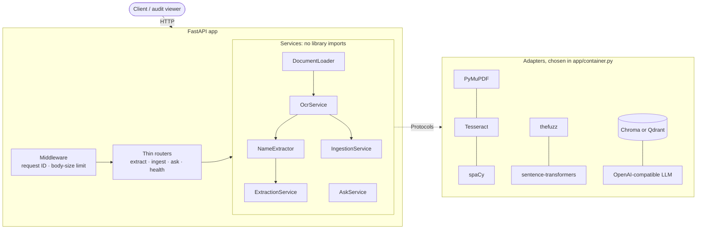
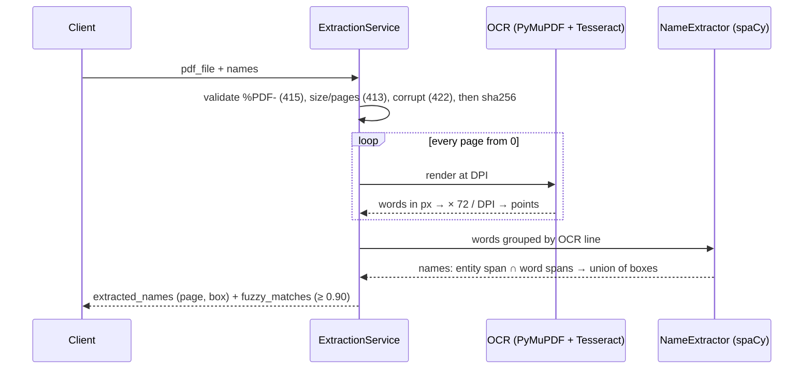

# DESIGN

A service that finds person names in scanned PDFs and returns each one **with its page and box**, so a compliance reviewer can verify it, and answers questions over ingested documents with grounded sources. Measurements behind each choice are in `DECISIONS.md`.

## Components

Routers parse and map; services hold the logic and depend only on Protocols; adapters wrap libraries, are built once at startup by `build_services`, and are replaced by fakes in tests. One module turns every error into `{"detail", "request_id"}`.

## Extract flow

Ingest reuses validation and OCR, chunks per page, embeds in one batch and upserts under `{sha256}:{page}:{chunk}`. Ask answers "not found" **without calling the LLM** below a calibrated similarity gate, and builds `sources` only from retrieved metadata.

## Technology choices

| Need | Choice | Trade-off accepted |
| --- | --- | --- |
| OCR | Tesseract `image_to_data` on PyMuPDF renders | We own pixel → point conversion; CPU-bound, ~1.5 s/page at 300 DPI |
| NER | spaCy `en_core_web_lg`, per OCR line | 55/55 vs 53/55 for `sm`, at ~400 MB; a name wrapped across lines is missed |
| Matching | `token_sort_ratio` after own normalisation | OCR noise (0.94) and a different person (0.93) look alike; scores go to the reviewer |
| Retrieval | `all-MiniLM-L6-v2`; Chroma embedded or Qdrant | Small CPU model, 256-token input; Chroma is simplest, Qdrant is a shared service |
| LLM | OpenAI-compatible; Ollama `llama3.2:1b` | No key needed; a 1B model misreads sometimes; a stronger one is a config change |

## Scaling to 1000+ PDFs per hour

**OCR is ~99 % of the work:** 1.5 s/page at 300 DPI (0.76 s at 150 DPI, same 55/55 on the samples), NER ≈ 0.015 s/page, embedding and storage milliseconds. **Sizing:** 1000 PDFs/h × 5 pages (conservative; the samples average 1.7) × 1.5 s = 7,500 core-s/h ≈ **2.1 busy cores**; with 3× peaks at 50 % utilisation, **~13 OCR cores** (e.g. 4 workers × 4 cores), half that at the scan's native 150 DPI. Tesseract runs single-threaded (`OMP_THREAD_LIMIT=1`), one process per core: parallelism comes from pages.

1. **API** validates, stores bytes in object storage under their SHA-256 (same hash → reuse the result) and enqueues; small files stay synchronous, large ones get `202` + job ID.
2. **Queue with one message per page** (SQS / Redis Streams), dead-letter after N attempts, so a 200-page file spreads over all workers.
3. **OCR workers**, autoscaled on queue depth, cache word boxes under `sha256:page:dpi`; extract **and** ingest read it, so a file is OCR'd once (today each endpoint OCRs it).
4. **NER and embedding workers** load models once per process and batch (e.g. 64 chunks); **Qdrant** replicated with a `doc_id` payload index; job status and results in Postgres.

## Failure modes and mitigations

| Failure | Mitigation (✓ = implemented) |
| --- | --- |
| Not a PDF, empty, corrupt, encrypted | ✓ checked by content before parsing → 415/422 |
| Huge upload or page count | ✓ 413 before the body is spooled; ✓ page limit; per-page jobs at scale |
| Tesseract missing or slow | ✓ per-page timeout → 503 naming the page; ✓ `/health/ready` reports it |
| Low-quality scan | Per-name OCR confidence is computed (not yet exposed); route low-confidence names to human review |
| LLM down, slow, rate-limited | ✓ timeout + retries → 503; ✓ readiness "degraded"; circuit breaker at scale |
| Vector store down | ✓ Qdrant retries transient errors → 503; queued ingest jobs replay |
| LLM invents an answer or source | ✓ no LLM call below the gate; ✓ sources only from retrieved metadata |
| Crash during re-ingest; model download at start | ✓ upsert-then-prune; ✓ models baked into the image, offline |

## Routing between models by query complexity

Most questions are lookups ("Who was promoted to VP?"): one chunk scores high and a small local model answers. Comparisons and aggregations across documents need a larger one.

1. **Route on signals the service already logs:** best similarity and its gap to the second, chunks above the context floor, distinct documents among them, question length, words like *compare, total, all, why*. Start with rules: one strong chunk from one document → `llama3.2:1b`; several documents or aggregation words → a 3B or hosted model.
2. **Escalate** when the small model says "not found" although similarity is well above the gate, or its answer fails a groundedness check (each sentence must overlap a cited chunk).
3. **Measure, then learn:** log route, latency, cost and reviewer feedback; replace the rules with a small classifier once there is data. Grounding is identical on every route, so a cheaper model can only be wrong about pages it was given.
