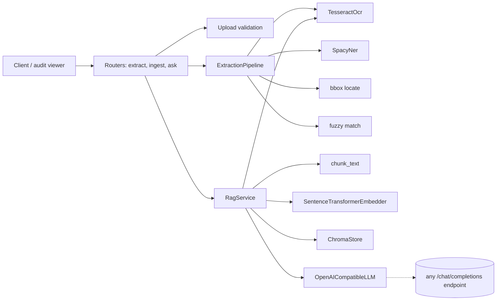

# Design

A FastAPI service that turns scanned PDFs into person names with page-level bounding
boxes, fuzzy-matches those names against a supplied list, and answers questions over
ingested documents with retrieval-augmented generation. Everything runs in one process;
the only external call is the LLM.

## Components

Routers validate the request, hand bytes to a pipeline, and map domain errors to HTTP
codes. Pipelines own the logic and depend on five Protocols (OCR, NER, embedder, vector
store, LLM). The real implementations are built once at startup in the lifespan and
injected through `app.state`; tests swap in fakes with `dependency_overrides`. The bbox
locator, fuzzy matcher, and chunker are pure functions because nothing needs to be
swapped there.

## Sequences

`POST /api/extract`

1. Read the upload in 1 MB pieces, rejecting empty, oversized, or non-`%PDF-` content.
2. Render every page with PyMuPDF at `OCR_DPI`, run Tesseract `image_to_data`, and scale
   each word box from pixels to points using the page rect. The result is a list of pages
   with words that carry `(block, paragraph, line)` from Tesseract.
3. Run spaCy on each page's text, keep PERSON entities, clean them, drop single tokens.
4. For each name, slide a window over each page's words. A window matches when every
   word fuzzy-matches its name token and the window stays on one line or wraps to the
   next. The union of the matched word boxes is the name's box. One box per occurrence.
5. Fuzzy-match the located names against the request list and return the fixed schema.

`POST /api/ingest`: OCR as above, chunk each page's text on word boundaries with overlap,
embed, and store with ids `{uuid}:{chunk_index}` and a source string that names the
file, content hash, page, and chunk.

`POST /api/ask`: embed the question, take the top `TOP_K` chunks, ask the LLM to answer
from that context only, and return the sources of the retrieved chunks. With an empty
store the service answers without calling the LLM.

## Technology choices

| Choice | Why | What I gave up |
|---|---|---|
| Tesseract via PyMuPDF | Free, offline, returns word boxes with layout structure I need for name matching | Accuracy on poor scans; a cloud OCR would do better on handwriting and skew |
| spaCy `en_core_web_sm` | Fast on CPU, PERSON label, tiny | Misses some names in OCR noise; `en_core_web_trf` is better and 10x slower |
| `thefuzz` full-string ratio | Robust to OCR noise, cheap, and does not inflate substrings the way `partial_ratio` does | Two people with near-identical names can score above threshold (Patel vs Patil at 0.91) |
| `all-MiniLM-L6-v2` | 384-dim, fast on CPU, good enough for short chunks | Weaker than larger embedders on long or technical passages |
| Embedded Chroma | Zero infrastructure, persisted to a directory, cosine HNSW | Single process, no sharing between replicas |
| OpenAI-compatible HTTP | Works with OpenAI, vLLM, Ollama, LiteLLM without code changes; tested against a self-hosted Qwen3.8 27B on vLLM | No streaming, no structured outputs |
| CPU-only torch | Image size and no GPU assumption | Slower embeddings under load |

## Scaling to 1000+ PDFs per hour

That is about one PDF every 3.6 seconds. Tesseract at 300 DPI takes 1 to 2 seconds per
page on one core, so a single instance handles a few hundred pages an hour at best. The
path is:

- Put uploads in object storage and a job id in a queue. The HTTP handler returns 202
  and the client polls, or a webhook fires when done.
- OCR workers are CPU-bound and stateless, so they scale horizontally. Pages of one
  document can be processed in parallel and merged by page index.
- NER and embeddings move to a GPU worker with batching. Embedding 500-character chunks
  in batches of 64 is orders of magnitude cheaper than one call per chunk.
- Replace embedded Chroma with a shared store (Qdrant or pgvector) so every worker and
  every API replica sees the same index. This is a one-class change behind the
  `VectorStore` Protocol.
- Cache OCR results by content hash. Compliance systems re-upload the same document
  more often than you would expect.
- Keep the API pods small and the worker pools separately autoscaled on queue depth.

## Failure modes

| Failure | Behaviour today | Mitigation at scale |
|---|---|---|
| Garbage upload | 400 / 413 / 415 before any model runs | Same, plus virus scanning upstream |
| PDF opens but OCR finds nothing | 200 with empty lists; logged with page and word counts | Flag low word counts for human review |
| NER finds a name the locator cannot place | Dropped with a warning; never returned without a box | Return it with a `bounding_box: null` variant if the contract allowed it |
| LLM slow or down | Timeout, exponential backoff, then 503 with a clear message; sources are still real | Circuit breaker and a fallback model |
| LLM writes reasoning into the answer | `LLM_EXTRA_BODY` turns Qwen thinking off per request | Reasoning parser on the server |
| Chroma file locked or corrupt | Three quick retries, then 503 | Managed store with replication |
| Unhandled bug | JSON 500 with request id, traceback in logs | Alert on the 500 rate |

## Routing between models by query complexity

I would score each question before choosing a model, using signals that are free to
compute: question length, number of retrieved chunks above a similarity floor, spread
between the best and fifth similarity, and a small keyword list for reasoning verbs
(compare, explain why, summarise across). Short factual questions with one dominant chunk
go to a small model (Qwen 7B or Haiku class). Multi-document or analytical questions go to
a large model. Both sit behind the same `LLMClient` Protocol, so the router is a class
that holds two clients and a rule. Every answer logs which model served it and why, and
a failure on the large model falls back to the small one rather than to an error.
