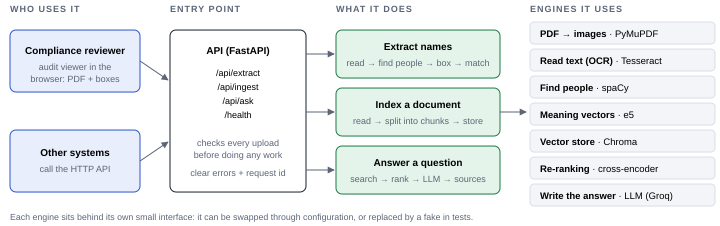
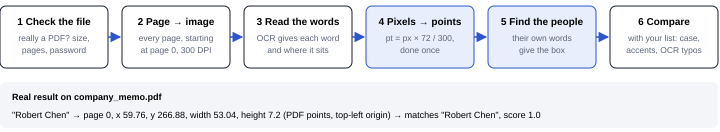
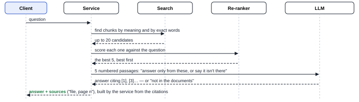
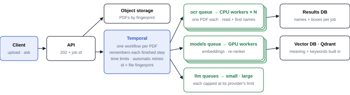

# DESIGN — Document Intelligence Service

> **3-page PDF version: [DESIGN.pdf](DESIGN.pdf)** — same content.

Give it a scanned PDF and it returns every person mentioned, with the page and the exact
box where the name sits, so a reviewer can check it. It also compares those names with a
list you send, and answers questions about uploaded documents, citing the page each
answer comes from.

| Names found that are real people / real people found | Boxes verified | Questions answered correctly (3 runs each) | Made-up sources |
|---|---|---|---|
| 100 % / 98 % | 54 of 54 | 15 of 15 | 0 |

## 1. How the pieces fit together

Each engine sits behind its own small interface: it can be swapped through
configuration, or replaced by a fake in tests.

## 2. Finding names and where they are

- **Boxes are in PDF points, not image pixels** (72 per inch, origin at the top-left), so
  they line up with the PDF whatever resolution was used to read it.
- **The box comes from the person's own words.** The name finder marks a person in the
  page text; we take exactly the OCR words it covers and draw the box around them. A name
  that appears five times gets five boxes, and titles like "Dr." stay outside.
- **Matching compares whole names**, ignoring case, accents and punctuation:
  *María González* matches *Maria Gonzalez*, but *Ana* does not match
  *Ana María Rodríguez*.

## 3. Answering a question

- **Indexing.** Each uploaded document is read the same way, then split into chunks of
  whole paragraphs (never cutting a word, never crossing a page). Chunk ids start with a
  fingerprint of the file, so a second document can't overwrite the first and uploading
  the same file twice doesn't duplicate it.
- **Two searches, then a ranking.** A search by meaning finds paraphrases; a search by
  exact words finds names and figures the first one misses. A re-ranker then reads each
  candidate next to the question and keeps the best five.
- **The LLM decides if the answer is there.** It answers only from those five passages,
  or says it isn't in the documents. We first tried a score cut-off to decide that, and
  dropped it: it rejected easy questions like "Who is the CEO?".
- **Sources can't be invented.** The LLM only cites passage numbers; the service turns
  them into "file, page n" from the passages it actually sent.

## 4. Technology choices and trade-offs

| Need | Choice | Why | Trade-off |
|---|---|---|---|
| Read text | Tesseract | Free, runs on CPU, gives each word's position | Weak on poor scans; a cloud OCR could replace it |
| PDF → images | PyMuPDF | Fast, knows page sizes in points | AGPL licence; pypdfium2 if that matters |
| Find people | spaCy, large English | Best on our samples; the small one took a project for a person | ~400 MB more; weak on ALL CAPS |
| Compare names | rapidfuzz | Whole-name similarity, fast | Fixed 0.90 threshold (configurable) |
| Search by meaning | e5 multilingual + Chroma | Spanish and English, no extra servers | One writer; a database service at scale |
| Rank results | Multilingual cross-encoder | ~1.5 s per question on CPU | A stronger one took 21 s on CPU |
| Write answers | Groq, gpt-oss-120b | Free, fast; any OpenAI-compatible provider | Free-tier limits; text leaves the machine |

## 5. Scaling to 1000+ PDFs an hour

Today one process does everything: it reads the PDF, embeds it, stores it and answers questions. To scale we follow a document and a question through our own components, find where each one gets stuck, and fix that point.

| Path | Stage | Where it gets stuck today | Fix at scale |
|---|---|---|---|
| Document | Read + find names | The request does the work in the one API process: a few big PDFs at once fill the CPU and the other requests wait | The API stores the PDF and returns a job id; Temporal queues one workflow per PDF; OCR workers pull from the queue and are added as it grows |
| Document | Embeddings | The model runs on CPU inside the API, loaded again in every process | Model workers on GPU, embedding many chunks per call |
| Document | Vector DB writes | Embedded Chroma: one process owns its files, so many workers can't write to it | Qdrant service: many writers at once, more replicas as data grows |
| Question | Hybrid search | Keyword search reads every stored chunk on every question: slower with each document added | Qdrant runs meaning + keyword search on its own indexes (bge-m3 gives both vectors from one model); read replicas for many questions |
| Question | Re-ranking | ~1.5 s of CPU per question inside the API; a burst of questions queues up | Re-ranker on a GPU model server that scores several questions together |
| Question | LLM | Free tier with a per-minute limit; a burst gets rejected | Paid tier; calls go through a queue capped at the limit, so they wait instead of failing; simple questions use the small model (§7) |

**Temporal** is a workflow engine built on queues and workers. Each PDF is one **workflow**, our recipe: check, read, find names, split, embed, store. Each step that calls an engine is an **activity**, with its own time limit and retries. Activities wait in **task queues** that **workers** pull from.

**Why Temporal and not a plain queue.** It remembers every finished step: a worker that dies mid-PDF is replaced and the PDF carries on from the last finished step. Temporary failures are retried with growing waits; a bad file fails once. The file's fingerprint is the workflow id, so a duplicate upload runs once. A queue can be capped at a provider's limit, and every step stays in history: an audit trail.

**Engines that fall short.** Each engine sits behind its own interface, so a replacement is a plug-in plus a config change, kept only if it wins on a golden set of real documents. Embeddings, re-ranker and LLM already handle Spanish; OCR and the name finder do not.

| Engine | What falls short | At scale |
|---|---|---|
| Find people | No real names on an ALL-CAPS Spanish property certificate | Rewrite ALL-CAPS lines in normal case (same length, boxes don't move); then measure a multilingual model such as GLiNER |
| Read text | English only | Spanish language pack: a config change |
| Rank results | The stronger re-ranker took 21 s on CPU | bge-reranker-v2-m3 once it runs on GPU |

## 6. What can go wrong and what happens

| Failure | What we do | Caller sees |
|---|---|---|
| Not a PDF, empty, too big, too many pages, password | Checked before any work starts | 4xx with a specific code |
| OCR engine missing or stuck | Time limit per page | 503 |
| Poor scan | Words the OCR is unsure of are dropped: no box over noise | fewer names |
| LLM slow, busy or down | Time limit and automatic retries; names and indexing keep working | 503 / 502 |
| Answer not in the documents | The LLM says so; an answer citing nothing is "not found" | "not found" |
| A document tries to give the LLM orders | Document text is marked as data; the LLM has no tools | normal answer |
| Same file uploaded twice | Same fingerprint, so it replaces itself | no duplicates |
| Text in ALL CAPS, other languages | Known limits of the name finder; fix in §5 | fewer names |

## 7. Choosing a model by question difficulty

An **orchestrator** in front of the models picks one, checks its answer and escalates when
needed: a short Temporal workflow the API waits on, deciding in plain code (cheap,
reproducible).

- **Classify from the question's words:** "compare", "why", "total", "difference" or more
  than one name → large model; otherwise → small, cheap model. Search, embeddings and
  re-ranking are shared; each model is a config entry with its own capped queue.
- **Check, then escalate once:** if the small model says "not found" or cites nothing
  valid, the large one gets the same passages. Citations are the signal we trust;
  re-ranker scores are not (answerable and unanswerable questions score alike).
- **Measure:** log route, model and cost per question; tune the rules on questions kept
  apart from the test set.

Details: [DECISIONS.md](DECISIONS.md) (decisions, limitations, use of AI).
