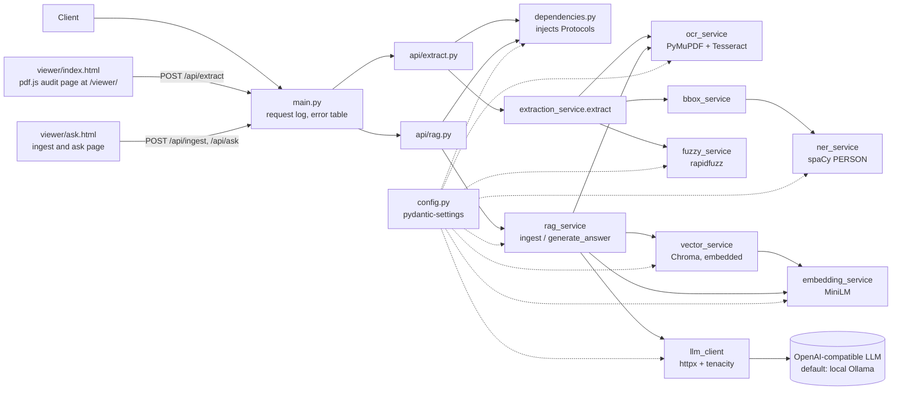
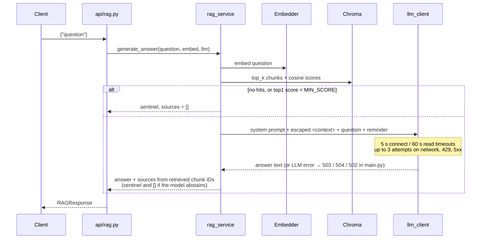

# Design

How the service is built and how it would grow. The reasoning, measurements and references behind each choice are in [DECISIONS.md](DECISIONS.md). How to run it: [RUNNING.md](RUNNING.md).

## 1. Components

- **Thin routers.** Each endpoint reads the request, receives its collaborators through `Depends`, and calls one plain function.
- **Services depend on Protocols.** `OcrEngine`, `NameRecognizer`, `Embedder`, `LLM`, `ChunkStore` and `ChunkSearch` are small callables. `dependencies.py` supplies the real ones; unit tests swap in fakes through `app.dependency_overrides`, so no model, network or LLM runs in them.
- **Functions where there is no state.** The only state is the loaded models and the Chroma client, each created once per process on first use (`lru_cache`).
- **Domain errors, mapped to HTTP in one table** (`ERROR_STATUS` in `main.py`). Services never import FastAPI.
- **One source of configuration**, `app/config.py`: environment, then `.env`, then defaults. Hosts, models, thresholds, DPI, timeouts and limits are all settings, listed in `.env.example`.
- **Structured logs**: one JSON line per request (method, path, status, ms) and one per pipeline call (counts, abstention), tagged with `X-Request-ID`. Names and document text are never logged.

### Sequence: `POST /api/ask`

`/api/extract` and `/api/ingest` are straight lines. Both validate the upload (size, PDF by content, encryption, page count) and OCR every page. Extract then runs NER, takes each name's box from the OCR words its characters touch, and fuzzy-matches. Ingest chunks each page, embeds, and replaces the document's chunks.

Boxes are in PDF points (`page.rect.width / pixmap.width`, no DPI hard-coded), top-left origin like the page image. `BBOX_ORIGIN=bottom-left` gives PDF-native coordinates: `y_pdf = page_height - y - height`.

## 2. Technology choices

| Part | Choice | Main alternative | Why |
|---|---|---|---|
| OCR | Tesseract 5 + PyMuPDF, 300 DPI | cloud OCR | Local; boxes within ±2 pt of hand labels. PyMuPDF is AGPL: pypdfium2 for a closed product |
| NER | spaCy `en_core_web_sm` + 3 filters + document-level propagation | larger model, GLiNER | Precision 54/54, recall 54/55 on the samples, on CPU |
| Fuzzy | `rapidfuzz`, max(`ratio`, `token_sort_ratio`) after normalization | `thefuzz` | Same scorers without the wrapper or GPL `python-Levenshtein` |
| Embeddings | `all-MiniLM-L6-v2`, CPU | `bge-small-en-v1.5` | Tied on our 22 answerable questions |
| Vector store | Chroma, embedded, cosine | Qdrant, pgvector | Enough for one process (section 3) |
| LLM | OpenAI-compatible endpoint via `httpx`; default `qwen2.5:7b-instruct` on Ollama | OpenAI SDK, hosted model | Timeouts, retries and errors visible in one function; hosted model = three variables |
| Orchestration | Plain Python | LangChain | Nothing it would save is worth the dependencies |

The only deviation from the suggested stack is `rapidfuzz` for `thefuzz`. Ollama is an OpenAI-compatible endpoint, as the README allows.

## 3. Scaling to 1000+ PDFs per hour

**Measured** (16 logical cores, CPU, 300 DPI, 6 warm runs): OCR takes about 0.8 s per page and over 95 % of request time; NER takes about 20 ms per page; embeddings, boxes and fuzzy matching stay under 60 ms per document. Tesseract already runs on one thread here (`OMP_THREAD_LIMIT=1` changed nothing). One process handles about 4,500 pages per hour.

**Arithmetic.** 1000 PDFs per hour of `p` pages each need `ceil(1000 × p / 4500)` busy OCR processes. For 10-page contracts: 3, or 4 with 50 % headroom. OCR parallelizes by page, so throughput is bought with cores.

**What changes:**

1. **Asynchronous intake.** A new endpoint stores the PDF under its SHA-256 and returns `202` with a job ID. The synchronous `/api/extract` stays for small files; its contract is fixed.
2. **A queue and stateless OCR workers**, one process per core. Queues deliver at least once ([SQS](https://docs.aws.amazon.com/AWSSimpleQueueService/latest/SQSDeveloperGuide/sqs-visibility-timeout.html)), so jobs must be idempotent ([Celery](https://docs.celeryq.dev/en/stable/userguide/tasks.html)). They already are: `doc_id` is the SHA-256 of the bytes and re-ingestion replaces a document's chunks. Workers acknowledge after finishing and reserve one job per process (`task_acks_late`, `worker_prefetch_multiplier=1`; [Celery](https://docs.celeryq.dev/en/stable/userguide/optimizing.html)), which gives backpressure. Repeated failures go to a dead-letter queue. Long documents split into page jobs.
3. **Autoscaling on queue depth.**
4. **A vector database as a service.** Embedded Chroma is why the API runs one worker: with two processes on one path, the second kept querying a stale index, silently (measured). Qdrant's client presents local mode for development and server mode to scale ([qdrant-client](https://github.com/qdrant/qdrant-client)). Only `vector_service.py` and its settings change.
5. **Postgres for job state and audit** (status, attempts, timings, model versions). Today there is no state, so no database.
6. **No GPU**: OCR, over 95 % of the time, is CPU-only Tesseract. A GPU pays only if a larger NER or embedding model is adopted.
7. **Observability**: queue depth, p95 per stage, errors per status, via OpenTelemetry. Not built.

## 4. Failure modes

| Failure | Behavior | Limit or next step |
|---|---|---|
| Not a PDF (by content), corrupt, encrypted | 422 before OCR | — |
| Over `MAX_UPLOAD_MB` or `MAX_PAGES` | 413 | The body is already received; production needs a proxy limit |
| Tesseract missing or over `OCR_TIMEOUT_S`; Chroma error | 503 | — |
| Several workers on embedded Chroma | Not detected: stale index, no error | One worker (uvicorn's default); vector DB service to scale |
| Embedding model changed without re-ingesting | Detected on open → 503 | Re-ingest |
| LLM down, 429, 5xx | 3 attempts with jittered backoff, then 503 | — |
| LLM timeout | 504; worst case about 184 s on one thread | `def` endpoints share a thread pool ([FastAPI](https://fastapi.tiangolo.com/async/)) of 40 threads by default ([AnyIO](https://anyio.readthedocs.io/en/stable/threads.html)); a stalled LLM can fill it. Next: shorter read timeout for hosted models, circuit breaker |
| LLM rejects the request (4xx) or its reply has no text field | 502, upstream body not exposed | — |
| LLM reply is blank | Treated as an abstention: sentinel, no sources | — |
| Nothing relevant retrieved | Abstains without calling the LLM (`MIN_SCORE = 0.20`) | — |
| Context lacks the answer | Model replies with a fixed sentence; returned with no sources (4/4) | Misses the one two-document question (1/22) |
| Same request, different wording | Temperature 0 does not guarantee identical text: one answer changed minutes apart | Tests check correctness and abstention, not strings |
| Prompt injection in a PDF | Context delimited, escaped, marked as data; sources from code | 0/475 replies with the attacker's word, but 6 runs made the model abstain wrongly. Mitigation, not a guarantee |
| First request after start | Models load on first use: close to a minute for the embedding model (measured once, includes importing torch) and about 50 s for the first LLM call | Warm up at startup |
| NER miss | No box for that name (recall 54/55); ALL-CAPS headers dropped on purpose | `NER_DROP_ALL_CAPS`; larger model |

## 5. Routing between models by query complexity

Not built; this is how I would do it.

- **A cascade first, not a learned router.** Every question goes to the small local model; a cheap signal decides whether to escalate to a larger hosted one. FrugalGPT accepts the cheap answer when a scorer rates it above a threshold ([Chen et al. 2023](https://arxiv.org/abs/2305.05176)); Hybrid LLM reports up to 40 % fewer calls to the large model with no quality drop ([Ding et al. 2024](https://arxiv.org/abs/2404.14618)).
- **Signals already available:** top-1 retrieval score, number of distinct documents in the top-k, whether the small model abstained, question wording ("compare", "summarize").
- **First rule to test:** escalate when the small model abstains although retrieval is confident, or when the top-k spans several documents. It targets our one known miss.
- **Why rules.** RouteLLM's routers trained on one data source were close to random on others ([Ong et al. 2024](https://arxiv.org/abs/2406.18665), Sec. 5.1). With 22 answerable and 4 unanswerable questions, rules are honest; a learned router can come later from production logs.
- **Measure** on the evaluation questions: share escalated, accuracy and abstention per branch, latency and cost. Each tier is configured like today's LLM (`LLM_BASE_URL`, `LLM_MODEL`, `LLM_API_KEY`).
